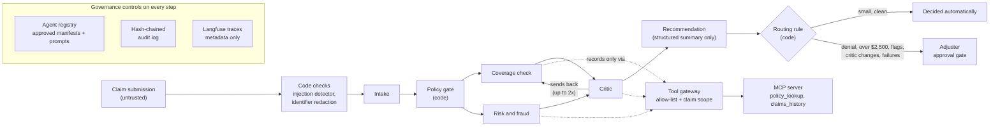

# hall-monitor

[](https://github.com/keeplearnin/hall-monitor/actions/workflows/ci.yml)
[](LICENSE)

Governance patterns for agentic AI in regulated financial services. Worked examples: insurance claims triage, then leave of absence, a complaint desk and partner marketing-fund claims.

Every agent needs a hall pass. hall-monitor checks it, watches where the agent goes, writes everything down, and calls a grown-up when it matters.

> **Status: early build, in public.** This repo is under active development (started November 2026). Each milestone ships with its eval numbers, including the bad ones. See [Roadmap](#roadmap) and [Results](#results).

## Why this exists

Most agent demos show what a model can do. Regulated firms need to know what an agent is allowed to do, who approved it, what it touched, and whether anyone can prove that six months later.

Those answers usually live in policy documents. hall-monitor puts them in code:

- **Every agent is registered** (its hall pass) before it can run, with a named owner, a risk tier and an explicit tool allow-list, and its owner can stop it at once (the kill switch).
- **Consequential decisions stop for a human**, and their decision is bound to the hash of the evidence pack they were shown.
- **Every triage and decision is logged** in an append-only, hash-chained audit trail that shows if anything was altered.
- **Every change is checked in CI**: tests, lint, the approvals check and the eval gate run on every PR, and CI fails a prompt or model change that has no new approval (the agent is also refused at run time until it has one). A failing check doesn't block a merge yet: that needs branch protection, which isn't on. *The gate doesn't yet block regressions: the published claims results were scored on earlier agent versions, so it warns about stale results rather than failing until a fresh baseline is published. The one live result on the currently approved agents, the leave path's, is a required check.*
- **Every control maps to a framework** (NIST AI RMF and the FINOS AI Governance Framework), so risk, compliance and audit teams can evaluate it without reading the code. See [`docs/controls.md`](docs/controls.md).

The governance layer is the product. The worked examples are the proof that it works on real-shaped regulated workflows.

## Worked examples

Four regulated-shaped workflows run on the same controls. Each has one page with the same headings: why the domain, what the agents do, what code decides, who decides, the data, results, how to run it and where the code lives.

| Example | What it shows | How far it's built | Live results |
|---|---|---|---|
| [Insurance claims triage](docs/examples/claims.md) | Five agents and a supervisor prepare a claim; code routes denials, large payouts, fraud flags and any failure to an adjuster, who signs the decision | Most complete: agentic path, approval gate, signed decisions, panel; adversarial and fairness results not yet published | Older agent versions only |
| [Leave of absence (FMLA)](docs/examples/leave.md) | Eligibility and entitlement rules in code; agents extract and explain; a signed sign-off checked against the role the rules name | Rules, agents, sign-off, panel cases, submission form | One run on the approved agents: 28 of 28 routed as the answer keys say |
| [Complaint desk on CFPB data](docs/examples/complaints.md) | Real public complaints; every one goes to a person; the system never replies to or sends anything to anyone | Ingestion, triage, evals, panel page, submission form | None: scripted runs only |
| [Partner rebate and marketing-fund claims](docs/examples/partners.md) | Proof checking where abuse hides: duplicates, split claims, changed payees; rules decide, agents read and flag | Rules and agents; no pipeline, evals or panel page yet | None: scripted agents only |

Some work runs on these examples without being one: the complaint investigation crew and the red-team arena use the complaint desk; the failure drills use the claims workflow; the agentic path (ADR 0028) runs in claims, leave and the complaint desk, and cost governance (ADR 0030) holds the live entry points' spending. They are listed in the [Roadmap](#roadmap).

To add a fifth, the `new-worked-example` skill in `.claude/skills/` sets out the order the first four were built in.

All data in this repository is synthetic, except one folder: the complaint desk's pinned snapshot in [`data/cfpb/`](data/cfpb/README.md) holds 500 real complaints from CFPB's public database, minimised (no company name, ZIP prefix only). No real customer, policy or claims data from any company is used.

## Architecture

How a claim moves through the claims example on the fixed order of steps (`agentic=False`), after milestone 11 and Phase B; by default the claims supervisor picks the steps within the same boundaries:



Every model call goes through one function that checks the agent's approved hall pass, calls the model the pass names, runs tool calls through the gateway and records what ran. Claims routed to a person wait at the approval gate (LangGraph, with state saved in SQLite) until an adjuster decides; every step is written to the audit log. More detail, and a plain-English version:

- [`docs/architecture.html`](docs/architecture.html), for engineering managers and architects
- [`docs/executive-brief.html`](docs/executive-brief.html), for business leaders
- [`docs/business-summary.md`](docs/business-summary.md), a business summary in plain English
- [`docs/pdf/`](docs/pdf/README.md), files to share: architecture and functionality diagrams (a four-page PDF, the controls page read from the register) and the executive briefing as a PDF and an editable Word document
- [`docs/leave-path.md`](docs/leave-path.md), the leave path told once, in a few minutes: from an employee's message to a signed decision, with the live result and what isn't covered
- [`docs/board-brief.md`](docs/board-brief.md), one page for a board or risk committee: the risks, the evidence, what isn't proven and the decisions a pilot would need
- [`docs/readiness-checklist.md`](docs/readiness-checklist.md), what a CIO and a Chief AI Officer would check, each item pass, partial or gap with its proof, and the top gaps
- [`docs/model-cards.md`](docs/model-cards.md), the AI use inventory and a model card per agent, generated from the registry and the published results
- [`docs/threat-model-agentic.md`](docs/threat-model-agentic.md), STRIDE for the agentic loop; [`docs/runbook.md`](docs/runbook.md), deploy, stop, restart, roll back and recover, with the kill-switch drill; [`docs/regulatory-mapping.md`](docs/regulatory-mapping.md), ISO/IEC 42001 and the EU AI Act, informally
- [`docs/adr/`](docs/adr/README.md), 34 architecture decision records: why each design choice was made and what it costs
- [`docs/review/`](docs/review/README.md), the external review package and a log of every review so far and what it changed

GitHub shows HTML files as source, so download them and open them in a browser.

Tracing sends IDs, versions, hashes and token counts to Langfuse, never claim text or policy records: trace decorators don't capture function inputs or outputs, and a function that raises marks its span with the exception's type only, never its message. The Anthropic SDK's own spans are metadata-only by default; nothing in the code stops someone setting `ANTHROPIC_OPEN_TELEMETRY_TRACES_CONTENT_MODE=content`, which would send content.

## Governance controls

Each control's NIST AI RMF and FINOS AIGF mapping is in the [controls register](docs/controls.md); the Register column gives its ID there.

| Control | What it does | Register | Status |
|---|---|---|---|
| Agent registry | Typed manifest per agent: ID, owner, risk tier, model, allowed tools, version. Unregistered, inactive or unapproved agents are refused at run time: the manifest digest and the system-prompt template hash must match `registry/approvals.yaml`, and the template hash is recorded on every call. The approvals file is a committed diff; who may approve it depends on repository settings (CODEOWNERS and branch protection). | HM-01, HM-02 | Built (milestones 1 and 3) |
| Kill switch | Each agent's owner is a named person (`registry/owners.yaml`). An owner stops an agent with one command (`python -m hall_monitor.kill_switch stop`), which appends to `registry/stops.yaml` and needs no approval; the registry reads that file on every check, so a running pipeline refuses the agent from its next model or tool call and sends the claim to a person, and a claim already under way that used the agent's answer is checked again before routing and goes to a person too. An unreadable stop list refuses every agent. Restarting needs the stop cleared in a reviewed approval (`python -m hall_monitor.approvals --resume`), and CI fails a pull request that deletes a stop. Both rules rely on branch protection, which isn't on yet. | HM-19 | Built (Phase B) |
| Tool allow-list | Agents can call only the MCP tools their manifest names; the gateway refuses anything else and records every call, allowed or refused | HM-03 | Built (milestone 4) |
| Adjuster approval gates | A LangGraph interrupt pauses every claim the routing rule sends to a person, with state saved in SQLite so it can wait across restarts. A decision counts only if it is signed with the adjuster's Ed25519 key, over the claim, every decision field and the evidence hash; code then checks their authority limit (for denials as well as payments), payout bounds on USD claims, that only a senior adjuster pays a claim with a fraud flag or above-low risk or one the AI never assessed, or pays or denies a claim whose amount can't be compared with USD limits (a junior adjuster may still send it for investigation or more information), and that overrides and denials carry a reason. The adjusters file, with each adjuster's authority, is approved by digest like the budgets: while it isn't the approved version every decision is rejected. The evidence pack is stored in the audit database under its hash, and the review step refuses a pack from the checkpoint that doesn't match it. The two fictional adjusters use public demo keys. | HM-04, HM-05 | Built (milestones 5 and 11) |
| Tamper-evident audit log | Append-only SQLite log; each entry's hash covers the previous one, triggers refuse edits and deletes, and `verify` reports any changed, missing or reordered entry. Events are written as they happen, so a run that dies part-way still leaves its trail. Entries hold IDs, hashes, decisions and costs, not the claim narrative or documents, and keep the adjuster's ID and keyed hashes (HMAC) of their written reason, of what each agent was sent and of each tool result, rather than the text; they do include policy numbers, decision fields and tool-call arguments. Someone with write access to the file could rewrite the whole chain consistently, so copy the chain head (`audit head`) somewhere else and verify against it. | HM-06 | Built (milestones 6 and 11) |
| PII and health-data redaction | Identifiers no agent needs (dates of birth, emails, phones, card numbers, passport and SSN numbers, IBANs, and labelled tax IDs, bank account and routing numbers) are removed from the claim text, attachment file names and tool results before any model sees them; counts by type are recorded. Medical details stay, because coverage depends on them. Data classes are enforced at run time: each tool declares the classes it carries (pii, health, financial), and so does the recommender's input; the other agents' inputs declare nothing and are taken to carry every class, which their manifests allow, so in practice the input check constrains only the recommender. Anything beyond the agent's manifest is refused before the model or tool is called, so the recommender can't receive claim text, names or claims history (its structured input is still declared as health data, because a claim type or clause number can reveal a medical claim). No claim narrative in traces or the audit log. | HM-10, HM-11 | Built (milestones 8 and 11) |
| Model routing | A manifest may name a cheaper approved model and a claim-size limit; a code rule uses it for small claims, and critic-driven revisions always go back to the main model. Off by default until it is evaluated (`--model-routing`). | HM-16 | Built, off by default (milestone 7) |
| Cost and value telemetry | Cost per claim on every result and in the audit log, cache-aware, by agent and model; time to triage; human override rate; stopped-claim rate. The policy wording is prompt-cached. | HM-16 | Built (milestone 7) |
| Eval harness | Extraction accuracy, coverage-reasoning accuracy (with clause precision), hallucination rate, routing, cost and simulated override rate against ground truth; a seeded-error test of the critic; every run published with its findings | HM-12, HM-13 | Built (milestones 2-3, extended since) |
| Critic review | A second agent checks intake, coverage and risk against the documents and sends errors back; every revision is kept, and one that changes a decision field goes to a person | HM-07 | Built (milestone 3) |
| Prompt-injection defences | Claim text is fenced and escaped; a code detector (shared by every example, with each one's own vocabulary, reading text decoded until stable and with look-alike letters mapped) sends text aimed at the AI to a person; tool lookups are limited to the claim's own policy. It is a pattern list, a tripwire, not a classifier | HM-09 | Built (milestones 3, 4 and 8) |
| Fairness checks | Counterfactual runner: each claim re-run under names associated with six groups, swapped everywhere the name appears, counting outcome flips and per-group payment rates (`evals.fairness`). | HM-14 | Built; results need a live run (milestone 8) |
| Adversarial test suite | Ten attacks planted in real claims (instruction override, forged reviewer tags, claimed prior approval, data exfiltration, forged documents, PII) and scored on whether any worked (`evals.adversarial`). Defences: escaped claim text, a code detector that sends flagged claims to a person, and tool lookups limited to the claim's own policy. | HM-15 | Built; results need a live run (milestone 8) |
| CI eval gate | Every PR runs `evals.gate`: published results must meet the thresholds in `evals/gate.yaml` (accuracy, hallucination, unsafe routes, critic catch rate; attacks and fairness once run), a metric that isn't a finite number fails, and results scored on agent versions or prompts that are no longer approved, or that don't record them, are flagged. The live leave-path run is a required check. Live evals run on demand from a manual workflow. | HM-17 | Built (milestone 9); stale results warn until a fresh baseline |
| Leave rules in code (HR) | FMLA eligibility, entitlement in workweeks under each leave-year method, and routing to the least senior HR role that may decide, all in code with no model, against 28 boundary requests with hand-worked answer keys. A missing fact is "can't decide", never a failure; every check that didn't pass and every flag goes to an HR business partner or above; only a clean request goes to the employee's local manager, as a draft to sign. The agents (HM-22) and the signed sign-off (HM-23), which enforces the named role, are separate controls; the rules aren't reviewed by HR or a lawyer, and state laws aren't modelled. | HM-21 | Partial: rules not reviewed by HR or a lawyer (HR example) |
| Control panel | A read-only web panel and JSON API (`python -m hall_monitor.panel serve`): an overview per workflow (claims and leave requests) with what needs attention first, the agent inventory with each agent's owner, approval, stops and eval results, the review queues for claims and leave requests, each case's and leave request's full audit trace (for a leave request: its state, route, outcome and who decided, never its reasons, checks or weeks, or anything from its evidence pack), audit-chain verification against an anchored head, the eval gate and the controls register. Each view asks the code that enforces the control (an agent's state is the registry's own run-time check). Every route is GET, the audit log is opened read-only and the checkpoints are never opened. Case traces show an allow-list of each audit event's fields, so no free text the model wrote (tool arguments, policy numbers it read) reaches a page, and no page shows claim text, kill-switch stop reasons, adjusters' reasons or signatures. No sign-in yet, so it serves this machine only; stopping and deciding stay in their CLIs. `snapshot` saves it as static files; `demo` builds demo data offline with a scripted model, labelled on every page. | HM-20 | Built, read-only (control panel phase 1) |
| Leave agents (HR) | A leave intake agent extracts dates and categories from the employee's redacted message, with no free-text field for a diagnosis; the rules in code decide on what it extracts; a leave explanation agent that never sees the message writes an advisory note. Same registry, approvals, kill switch, data-class check and audit log as the claims agents. Text aimed at the AI and any failure of intake or the rules send the request to a person. An eval scores intake against the answer keys; one live run (28 synthetic requests, all routed and extracted as the keys say, $0.026) is published and required by the CI gate. A failure of the intake call leaves no evidence pack, so the request can be prepared again; any other failure goes to HR with what was found. | HM-22 | Partial: one live run on 28 synthetic requests (HR example) |
| Leave submission form (HR) | A separate local form (`python -m hall_monitor.hr.submit`) adds leave requests to HR's queue through the same pipeline as `hr.run`, so the panel stays read-only. It decides nothing and shows the submitter only the request's ID and state. Demo mode uses the scripted model on the synthetic messages and calls no API; live mode takes free text and calls the Claude API, up to a per-run cap. No sign-in, so it serves this machine only, and a submission must carry the form's token and come from its own origin. Live mode is tested only with a fake client. | HM-24 | Built (HR example) |
| HR sign-off | A person decides each prepared leave request, signed with their Ed25519 key over the evidence pack the audit log recorded. Code enforces their role against the one the rule named, approves FMLA leave only for an eligible employee within the weeks left, asked and qualifying, lets the local manager approve only the plain light-path case, lets only HR business partners or above deny (fully or in part, including approving fewer weeks than asked) or approve military leave on a written attestation of the family member's status, and only directors extend past the entitlement, and needs a reason for any denial, extension or approval against the route. Asking for more information leaves the request waiting. One decision per request; every refusal that reaches the rules is logged, naming staff only if they signed it. The log keeps keyed hashes, not the reason or signature. Fictional staff use public demo keys. | HM-23 | Built (HR example) |
| No reply, no send | The system never replies to, contacts or sends anything to anyone. One outbound data path (`hall_monitor/egress.py`): GET over https to the CFPB complaint API only, every other request refused before it leaves and logged, redirects never followed; the desk's model client is guarded to the Claude messages endpoint. A read-only tool catalogue: a manifest granting any other tool is refused at run time and for approval, and the gateway won't serve one. Drafts have no delivery field and are logged as never sent. A static check in CI fails on the sending capabilities it knows (a tripwire, not a proof). The Anthropic SDK and Langfuse are third-party code the check doesn't read; Langfuse's client isn't behind the guard. | HM-25 | Built (complaint desk, slice 1) |
| Complaint ingestion | Public CFPB complaints through one read-only MCP tool behind the gateway, pipeline only, every call logged; GET only, through the egress guard, spaced and retried with backoff. Minimised at the door (no company, ZIP prefix), validated strictly, deduplicated by complaint ID with versions for changes, bad records quarantined with field names and error types only. Pulls resume after a cursor, stop at the desk's capacity, and snapshot every page with hashes; the pinned snapshot reproduces evals offline. Tested against a fake CFPB and one live pull. | HM-26 | Built (complaint desk, slice 2) |
| Complaint triage | Every complaint goes to a person. Code on CFPB's labels sends fraud, identity theft, foreclosure, discrimination and Older American or Servicemember complaints to specialist review at high urgency, whatever the agent says; the agent (no tools, untrusted input, no ID or location) only adds concerns or urgency, and its low confidence, disagreement or failure goes to specialist review too. Drafts that promise an outcome or carry any way to reach someone are dropped (a strict pattern list); the rest are kept, never sent. A changed CFPB record that adds a code reason, raises the urgency floor or adds a narrative is re-routed to specialist review, never lowered (a routine status change isn't); a triage agent stopped after it answered has its answer discarded. The log holds codes, keyed hashes and cost. Not run live. | HM-27 | Partial: built, not run live (complaint desk, slice 3) |
| Complaint evals and panel page | On the pinned snapshot, scored by code against a hand-written label key: every must-route complaint to specialist review at high urgency, every untimely one too, no drafts with a delivery path, no flip when the state or ZIP prefix changes; gated in CI. Group rates by ZIP region and tag reported. The panel's Complaint desk page shows the queue and reasons, who answered each complaint (scripted stand-in, model, no answer), cost, pulls and the no-send status, with a banner when any answer is scripted. Published result is the scripted run; the model is not yet evaluated live. | HM-28 | Partial: scripted run only (complaint desk, slice 4) |
| Delegated passes only narrow | When an agent hands work to another, it does so under a grant for one case that can hold no tool or data class its parent's grant or the helper's own manifest doesn't. Handoffs must be declared in the hall pass; no loops; at most two handoffs; allotments only shrink; over-asking is refused and logged, not trimmed. Every use checks the whole chain against the registry, so stopping the lead stops its helpers at once. The tool gateway serves a crew agent only under a grant its case's book issued. No agent uses grants yet: the complaint crew comes in later slices. | HM-29 | Built, mechanism only (complaint crew, slice 1) |
| Red-team arena | Rounds of attacks against the complaint desk, judged by code: synthetic seeds (injection, fake urgency, a draft carrying a link, phone, email or promise, must-route complaints played down) rewritten by a fixed list of mutations, each round pressing only on what was blocked, against the real pipeline with a hijacked agent that does whatever the attack asks. Must-route is a human label, never read from routing. On the scripted run no complaint whose CFPB labels or tags call for a specialist was played down, and no agent or complaint text reached the log. Harm got through in 3 of 18 attacks (8 of 18 before review 38's fixes): the 3 must-route complaints that say what happened only in the narrative (fraud, a foreclosure sale, an older consumer talked into giving a card number) went to the standard queue, because routing reads only labels and tags. The planted drafts (a promise in plain words, a link, phone, email or promise hidden by encoding) are now refused by the stricter draft check, and the injections with entities encoded twice or look-alike letters are now flagged; both are still pattern lists. Published, not gated; no live attacker or model. | HM-30 | Partial: scripted run only (red-team arena, slice 1) |
| Failure drills | `python -m hall_monitor.drills` runs the synthetic claims through the real claims workflow several at a time, with failures injected on a seeded plan: wrong answers, answers of the wrong type, no answer, truncated answers, API errors and timeouts, a crash after the evidence pack is logged, the same claim submitted twice at once, an owner stopping the risk agent mid-batch, and a batch cost cap held with reservations. Checks read the audit log: every failed, crashed or stopped case that started ends with a person, none is left with no one, clean cases are handled normally, no case gets two evidence packs or two decisions (a duplicate submission can still run triage twice and pay for it twice), every failure shows in the log by its own reason (faults the stop reached first are listed as masked), the cost stays under the cap and the log verifies. A case the cap refuses is logged but never enters the workflow, so it isn't queued for anyone. Scripted model, claims workflow only, threads in one process; says nothing about the agents' accuracy. | HM-31 | Built (failure drills, slice 1) |
| Agentic workflows, bounded by code | Claims: a supervisor agent chooses each claim's next step (run a specialist, revise what the critic raised, finish or hand off) from codes and amounts only, never claim text or tool results. Code refuses a step whose inputs aren't ready or that repeats on unchanged inputs, checks a per-claim budget (steps, cost, time) and the kill switch before every step, and alone routes the claim: auto only if every required step ran on the latest inputs and the routing rule finds nothing for a person. Every choice is logged as codes. An offline eval runs hostile and noisy scripted supervisors against the fixed order on every claim: none got a claim through that the fixed order sent to a person. Complaint desk: a desk supervisor chooses triage, one independent re-check, finish or hand-off; every triage counts, disagreement or a hand-off adds specialist review, a complaint no agent read goes at high urgency however the loop finished, stopped or was interrupted, and no policy in the offline eval gave any of the 500 pinned complaints less review than the fixed order. HR leave: a leave supervisor chooses intake, one re-check before the rules, the rules, the note, finish or hand-off; the rules always run on the first intake, a disagreeing re-check or a hand-off adds HR review, and a request routed before the rules ran goes to an HR director; no policy in the offline eval gave any of the 28 requests a lighter route or a less senior role. The leave supervisor has one live run (28 synthetic requests, all routed as the keys say); the claims and desk supervisors have none, so how well they choose is unmeasured. | HM-32 | Partial: scripted runs, and one live run of the leave path |
| Complaint submission form | A separate local form (`python -m hall_monitor.complaints.submit`) adds a typed-in synthetic complaint, with a `syn-` ID that can't be a CFPB one, and runs it through the desk's own agentic pipeline, so it shows on the panel's Complaint desk page; the panel stays read-only. The submitter sees only its ID and state. Demo mode uses the scripted stand-in and calls no API; live mode uses the desk's guarded model client, up to a per-run cap. The leave form's protections: this machine only, the form's token and its own origin. Live mode is tested only with a fake client. | HM-33 | Built, proposed (complaint desk) |
| Approved budgets and spending caps | Each workflow's case budget, daily and monthly spending caps and owner, and the model price table, live in `registry/budgets.yaml`, approved by digest like a hall pass. Every case reads it before any model call; the live entry points reserve each case's budget against its workflow's caps in a ledger shared by every process on the machine, and a case that would pass a cap, or finds the budgets unapproved, goes to a person with no model call. Per-agent caps, signed spend approvals and a cost page are next; the evals' live runs aren't held to the caps yet. | HM-34 | Built (cost governance, slice 1) |
| Agents act within their grant | A crew agent runs only under a grant from its case: refused before any model call without one; every round re-checks the whole chain (a stop halts it between steps); every model call is charged to the grant and a run over its allotment stops and goes to a person; its tools are the grant's. A lead hands work to a helper through a `hand_off` tool: declared helpers only, an allotment set by code, the task fenced as untrusted and taken to carry every data class the lead holds, the helper's answer returned as data, a helper's failure returned as its error type only. Tested with scripted clients; no crew agents yet. | HM-35 | Built, mechanism only (complaint crew, slice 2) |
| Partner claim rules in code | The partner claims example starts with its rules and no model: every claim goes to a person (compliance review, hold, review or expedited sign-off) with fixed reasons for pre-approval, timing, eligibility, evidence, third-party invoices, caps, benchmark rates, competitor content, duplicates, split claims, the payee, partner status and text aimed at the AI; what may be reimbursed is reported in exact decimals; the deciding role follows an assumed dollar ladder. Scored against 47 hand-written answer keys. | HM-36 | Partial: rules built (partner claims, slice 1) |
| Partner claim agents read and flag | An intake agent extracts the invoice and dates from redacted, fenced documents; code checks every number, name and date against the documents' text (a unit count must be written as units and times its stated price make the line amount, the activity dates must be the pair written together, the issuer must come from the invoice header, not the Bill-to party) and sends a claim with an unsupported value to review, and a failed extraction reimburses nothing and keeps every finding that needs no invoice. A stop made while a claim is prepared discards the agents' answers; each claim is held to the partners budget and caps. A proof reviewer raises concerns from a closed list of five, each a fixed reason that only adds review. The portal's fields (partner, payee, amount claimed) never come from an agent. Line categories and two yes-or-no flags are trusted, a stated gap. Scripted agents only; no live run yet. | HM-37 | Partial: scripted agents only (partner claims, slice 2) |
| Framework mapping | 37 controls in `controls/controls.yaml`, each with its code and tests, and its published evidence where there is any (24 have none yet: 17 list none, HM-09, HM-14, HM-15 and HM-27 list only live runs still to be made, HM-31 lists only a drill report not yet published, and HM-29 and HM-35 list only the crew running under grants, still to be built), mapped to NIST AI RMF 1.0 subcategories and FINOS AIGF v3 risks and mitigations, with what isn't covered and why. Tests fail if a reference goes stale or an ID isn't in the locally checked list (`controls/frameworks.yaml`). Readable version: [`docs/controls.md`](docs/controls.md). | All | Built (milestone 9) |

## Results

Numbers are published as each milestone lands, from runs anyone can reproduce with the commands in this repo.

**The only live result on the currently approved agents is the leave path's.** The 28 synthetic leave requests went through the agentic leave path on the live model (`python -m hall_monitor.hr.evals`, [results](evals/results/hr-agentic-live/results.json)), on the approved leave intake (`leave-intake-v1`), leave supervisor (`leave-supervisor-v1`) and leave explainer (`leave-explainer-v2`), all on `claude-haiku-5-5`, at commit `99399d1` with a clean tree:

| Requests | Route accuracy | Intake field accuracy | Intake exact | Explanation failures | Errors | Cost |
|---|---|---|---|---|---|---|
| 28 | 100% | 100% | 28 of 28 | 0 | 0 | $0.026 in all |

What it can't show: it is one run, so run-to-run variation is unmeasured; the 28 requests are short and plainly worded, and the same person wrote them and their answer keys, so it says nothing about real employees' messages; no decision was signed, so the sign-off isn't exercised. The CI gate requires route and intake accuracy of at least 95% and no errors on it.

**Claims and complaints.** The claims agents have no live run on their current versions; the numbers below describe older claims agents. The complaint desk's agent has never run live, so it has no numbers here. *Every row below was scored on the fixed order of steps with earlier agent versions; the default path is now agentic (HM-32), and it has been compared with the fixed order only offline, with scripted supervisors ([agentic-scripted](evals/results/agentic-scripted/report.md)). Its live accuracy and cost are not yet measured.*

| Milestone | Extraction accuracy | Coverage-reasoning accuracy | Hallucination rate | Cost per claim | Human override rate |
|---|---|---|---|---|---|
| Baseline (single pass, 6 claims x 3 trials) | 100.0% | 83.3% | 0.0% | $0.024 | n/a |
| Baseline (single pass, 26 claims x 3 trials) | 98.3% | 89.7% | 0.0% | $0.022 | n/a |
| Milestone 3 fixes, no critic (26 claims x 3 trials) | 98.6% | 100.0% | 0.0% | $0.022 | n/a |
| Milestone 3 with critic (26 claims x 3 trials) | 98.9% | 100.0% | 0.0% | $0.038 | n/a |
| Hardened, no critic (34 claims x 3 trials) | 98.5% | 98.0% | 0.0% | $0.024 | 3.3% (simulated) |
| Hardened, with critic (34 claims x 3 trials) | 98.7% | 98.0% | 0.0% | $0.039 | 1.7% (simulated) |

The two baseline rows use the same code; the second runs on a larger claim set. Milestone 3 computes the coverage label in code and stops when a policy can't be found, which took coverage reasoning to 100% without the critic. The critic's measured gain is on fraud flags: precision went from 92% to 100%, at about $0.016 more per claim. The amount slips it was built to catch didn't occur in either milestone 3 run, so that gain isn't measured yet. The hardened rows add 8 claims where a cap decides the amount, and fix the high-severity findings from two code reviews. No claim was routed automatically when it needed a person in any run. In the hardened run the critic raised no issues, so the gap between those two rows is run-to-run variation. A separate eval measures the critic directly by planting one error at a time in otherwise correct work. It caught all 84 planted errors, including all 16 amounts that ignored a cap, and raised 1 false alarm in 34 clean cases ([findings](evals/results/critic-seeded/findings.md)). Milestones 4-8 (governed data access, the approval gate, the audit log, caching and routing, and the privacy and injection defences), milestone 11, and the work since (the Phase A review fixes, and in Phase B the fault-injection fixes, the kill switch and the tax-ID and bank redaction) have passed their offline tests but are not yet in a scored live run. The routing figures were scored under an older routing rule: the checks against the policy record (after milestone 11) and the claim documents (Phase B) came later and make it stricter. The pipeline numbers were scored at commit `d083a79` on intake-v2, coverage-check-v2, risk-fraud-v1, critic-v1 and recommendation-v2, and the critic eval at `ecd20c3` on critic-v1; every agent has been revised since (now intake-v3, coverage-check-v4, risk-fraud-v2, critic-v3 and recommendation-v3), so the numbers describe earlier versions until the next live run. Human override rate is simulated: an adjuster who always decides as the answer key does would have overridden the AI on 1 of 59 routed runs with the critic and 2 of 60 without, and no AI error went through automatically (`python -m hall_monitor.evals.override`). About 58% of runs go to a person, because the test claims are deliberately weighted towards edge cases. Details: findings for [6 claims](evals/results/baseline/findings.md), [26 claims](evals/results/baseline-26/findings.md), [milestone 3](evals/results/m3-critic/findings.md) and [the hardened pipeline](evals/results/hardened-critic/findings.md).

## Roadmap

1. ~~Repo, agent registry, synthetic claims and policies with ground truth, tracing~~ (done)
2. ~~Baseline eval run, results committed~~ (done)
3. ~~Critic agent and self-correction loop~~ (done)
4. ~~MCP servers: `policy_lookup`, `claims_history`~~ (done; eval results to follow)
5. ~~Adjuster approval gate with persistent checkpoints~~ (done)
6. ~~Hash-chained audit log~~ (done)
7. ~~Model routing and cost-per-claim telemetry~~ (done; routing to be evaluated)
8. ~~PII redaction, fairness checks and adversarial test suite~~ (done; attack and fairness results to follow)
9. ~~NIST AI RMF and FINOS AIGF mapping; CI eval gate~~ (done)
10. ~~Architecture decision records, one-page board brief, external review package~~ (done; reviews by people outside the project are invited)
11. ~~Hardening from the claims audit: audit events written as they happen, evidence stored by hash and checked before a decision, signed adjuster decisions, reasons hashed in the log, data classes enforced at run time, redaction of file names and tool results~~ (done)
12. ~~Phase B so far: fault-injection tests of every agent's answer, and the amount trace they led to; the kill switch; redaction of labelled tax IDs, bank account and routing numbers, and IBANs~~ (done; not yet in a scored live run)
13. Vendor test harness: adapters for guardrails, gateway policy and observability; routing and authority limits as policy code; OpenTelemetry export; automated anchoring
14. ~~Control panel, read-only: overview, agents, review queue, case trace, audit integrity, evals and controls~~ (done; no sign-in yet)
15. Control panel write actions and access: sign-in with four roles (viewer, reviewer, owner, approver), stopping an agent and signing a decision from the panel, a shared store for the audit log and stops
16. ~~HR leave example, rules first: FMLA eligibility, entitlement and routing in code, with boundary answer keys~~ (done; the agents, sign-off, panel cases and form followed in items 17 to 20)
17. ~~HR leave agents: intake and explanation, checked against the rules, inside the shared controls~~ (done; not run live)
18. ~~HR sign-off: a signed decision that enforces the role the rules name, on the evidence the log recorded~~ (done)
19. ~~HR cases in the panel, with demo data~~ (done)
20. ~~A form that adds leave requests to HR's queue, outside the read-only panel~~ (done; live mode not run against the API)
21. Complaint desk on live CFPB data ([design](docs/complaint-desk-design.md)): ~~the no-reply, no-send rule in code~~ (done); ~~ingestion with snapshots~~ (done); ~~triage with routing in code~~ (done; not run live); ~~evals, fairness and the panel page~~ (done; scripted run only); ~~a form that adds a typed-in complaint~~ (done, proposed; live mode not run against the API)
22. Complaint investigation crew ([design](docs/complaint-crew-design.md)): a lead agent hands parts of a case to helper agents: ~~delegated passes that only narrow, in code~~ (done); ~~agents act within their grant: spend charged, handoffs as a tool~~ (done; scripted clients only, no crew agents yet); the read-only tools; the crew and its first live run; evals and the panel page
23. Red-team arena against the complaint desk ([design](docs/redteam-arena-design.md)): ~~an offline attacker, a hijacked defender and a judge in code~~ (done; scripted run only, findings not yet fixed); a live attacker, the real model as defender, fixes and the gate next
24. Failure drills ([design](docs/failure-drills-design.md)): ~~many claims at once with failures injected on purpose, checked in code~~ (done; claims workflow only, scripted model); the complaint desk and HR pipelines and a panel page next
25. Agentic workflows within code-held bounds ([ADR 0028](docs/adr/0028-agent-picks-the-steps-code-holds-the-boundaries.md)): ~~claims~~ (done; scripted runs only, no live supervisor eval); ~~the complaint desk~~ (done; scripted runs only); ~~HR leave~~ (done; scripted runs only)
26. Cost governance ([ADR 0030](docs/adr/0030-cost-governance-budgets-and-caps.md)): ~~approved budgets, prices and daily and monthly caps per workflow, a case over a cap to a person~~ (done; live entry points only); per-agent caps and signed spend approvals for live runs; a cost page in the panel and a cost report
27. Partner rebate and marketing-fund claims ([design](docs/partner-claims-design.md), [ADR 0032](docs/adr/0032-partner-claims-rules-decide.md), [ADR 0033](docs/adr/0033-partner-claim-agents-read-and-flag.md)): ~~the rules in code, scored against hand-written answer keys~~ (done; no model); ~~agents inside the shared controls~~ (done; scripted agents only, no live run); the pipeline; evals and the gate; the panel page; a live run
28. ~~Review 38 fixes: a third-party review and an independent three-reviewer pass ([log](docs/review/log.md)): partner extraction checks, stops re-checked and budgets for partner claims; duplicate documents across claim IDs, refunds and named currencies in the claims amount trace; an approved adjusters file; gate metrics that must be finite; audit verify of trigger SQL and signed HR records; complaint re-routing on a changed record, a strict draft check and a wider injection tripwire; HR form fixes and military leave to a person; leave roles as a branch company runs them (local manager, HR business partner, HR director); the first live run of the agentic leave path~~ (done; claims and complaint agents still not run live on current versions; branch protection, demo keys and the partner flags still open)

Daily progress notes are in [`docs/devlog/`](docs/devlog/).

## Stack

Python 3.12 · uv · Claude (Haiku and Sonnet) · LangGraph · MCP via fastmcp · SQLite · Langfuse · Starlette

In use today: Python 3.12, uv, Claude Haiku 5.5 and Sonnet 5.5 through the Anthropic SDK, Pydantic, fastmcp, LangGraph with a SQLite checkpointer, a SQLite audit log, `cryptography` for signatures, Langfuse, and Starlette with uvicorn for the control panel. There is no Postgres, vector store or eval framework, and the only web API is the control panel's read-only one; the evals are plain Python scoring code. Postgres is the planned replacement for SQLite in production.

## Quickstart

`run` triages a claim with the claims supervisor choosing which of the five agents run, in what order (code checks each step and decides the route), then decides it automatically or leaves it waiting for an adjuster. It calls the Claude API; nothing else below does.

```bash
git clone https://github.com/keeplearnin/hall-monitor.git
cd hall-monitor
uv sync
cp .env.example .env   # add ANTHROPIC_API_KEY and Langfuse keys
uv run python -m hall_monitor.run --claim data/synthetic/claims/claim_001.json
uv run python -m hall_monitor.audit verify                 # check the audit chain
uv run pytest                                              # offline tests; no API calls
uv run python -m hall_monitor.evals.gate                   # check published results; no API calls
uv run python -m hall_monitor.panel serve                  # control panel at http://127.0.0.1:8765
uv run python -m hall_monitor.panel demo                   # demo data offline, scripted model; no API calls
uv run python -m hall_monitor.panel serve --demo           # the panel over the demo data
```

Each example's page lists its own commands, with what the live ones cost: [claims](docs/examples/claims.md#run-it), [leave](docs/examples/leave.md#run-it), [complaints](docs/examples/complaints.md#run-it), [partners](docs/examples/partners.md#run-it).

## Repository layout

```text
hall-monitor/
├── registry/                # Agent manifests, approvals.yaml, adjusters.yaml, owners.yaml, stops.yaml, manifest schema
├── hall_monitor/
│   ├── agents/              # Intake, coverage check, risk and fraud, critic, recommendation; base.py is the one call path
│   ├── tools/               # MCP server (policy_lookup, claims_history) and the tool gateway
│   ├── gateway/             # Cost, identifier redaction, injection detection
│   ├── governance/          # Routing rule, approval gate, audit log
│   ├── evals/               # Scoring, baseline, critic seeded test, override, adversarial, fairness
│   ├── panel/               # Read-only control panel: views, pages, app, snapshot, demo data
│   ├── hr/                  # Leave example: rules in code, agents, signed sign-off, submission form
│   ├── complaints/          # Complaint desk on CFPB data: CFPB tool, ingestion, store, snapshots, triage agent, routing, never-sent drafts, submission form
│   ├── partners/            # Partner marketing-fund claims: rules in code, intake agent, proof reviewer
│   ├── redteam/             # Red-team arena against the complaint desk
│   ├── egress.py            # The one outbound HTTP path, guarded: CFPB GET and the model API only
│   ├── no_send.py           # Read-only tool catalogue and the CI check for sending capabilities
│   ├── pipeline.py          # Claim triage
│   ├── workflow.py          # LangGraph workflow with the approval gate
│   ├── run.py, review.py, audit.py  # CLIs: submit a claim, review as an adjuster, verify the log
│   ├── kill_switch.py       # Stop an agent; CI's append-only check of the stop list
│   └── registry.py, approvals.py, models.py, tracing.py
├── data/synthetic/
│   ├── policies/            # Policy wording and policy records
│   ├── claims/              # 36 claim submissions
│   ├── ground_truth/        # Expected extraction, coverage, risk, next step and route
│   ├── claims_history.json  # Earlier claims, served by claims_history
│   ├── adversarial/         # Attack cases
│   ├── hr/                  # Leave requests, employees and answer keys
│   ├── partners/            # Partner claims, documents and answer keys
│   └── redteam/             # Synthetic complaints for the red-team arena
├── data/cfpb/snapshots/     # Pinned CFPB complaint snapshots (real, public, minimised; not synthetic)
├── controls/                # Controls register and the verified framework identifiers
├── evals/                   # gate.yaml thresholds; results/ holds published runs with findings
├── docs/                    # examples/ (one page per worked example), controls.md (generated), one-pagers, board brief, ADRs, review package, devlog
├── tests/                   # Offline tests; the Claude client is faked
├── var/                     # Runtime state: workflow checkpoints and audit log (git-ignored)
└── .github/workflows/       # CI on every PR; a manual live-eval workflow
```

## Design principles

- **Governance in code, not in documents.** If a control can't be tested, it doesn't count.
- **Humans make the consequential calls.** The agent prepares the evidence; an adjuster decides denials, large payouts and fraud.
- **Measure before you claim.** Every result in this README comes from a published run, with the agent versions it was scored on.
- **Model-agnostic by design.** Controls sit in the gateway and the graph, not inside one vendor's model.
- **Built for audit.** Any recommendation can be traced back to its inputs, model, prompt version, policy clauses and approver.

## Non-goals

- A production claims system. This is a reference implementation.
- A polished user interface. The evals, audit trail and control mapping are the point.
- Legal, compliance, underwriting or claims-handling advice.

## Contributing

Issues and pull requests are welcome, especially from people working on AI governance in insurance, banking and other regulated industries. If you've had to put an agent in front of an auditor or a regulator, I'd like to hear what they asked.

## Author

Built by Hari Perugu, engineering and AI platform leader in regulated financial services. [LinkedIn](https://www.linkedin.com/in/hariperugu/)

This is a personal project. It is not affiliated with, endorsed by, or built on the systems or data of any current or former employer.

## License

[Apache License 2.0](LICENSE)
