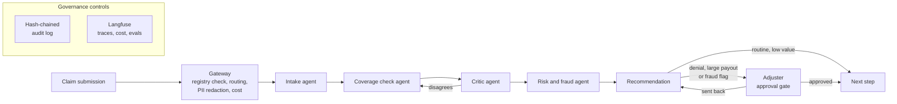

# hall-monitor

[](https://github.com/keeplearnin/hall-monitor/actions/workflows/ci.yml)
[](LICENSE)

Governance patterns for agentic AI in regulated financial services. Worked example: insurance claims triage.

Every agent needs a hall pass. hall-monitor checks it, watches where the agent goes, writes everything down, and calls a grown-up when it matters.

> **Status: early build, in public.** This repo is under active development (started November 2026). Each milestone ships with its eval numbers, including the bad ones. See [Roadmap](#roadmap) and [Results](#results).

## Why this exists

Most agent demos show what a model can do. Regulated firms need to know what an agent is allowed to do, who approved it, what it touched, and whether anyone can prove that six months later.

Those answers usually live in policy documents. hall-monitor puts them in code:

- **Every agent is registered** (its hall pass) before it can run, with an owner, a risk tier and an explicit tool allow-list.
- **Consequential decisions stop for a human**, and the evidence the human saw is recorded with their decision.
- **Every step is logged** in an append-only, hash-chained audit trail that shows if anything was altered.
- **Every change is evaluated in CI**, so a new prompt or model can't silently ship a regression.
- **Every control maps to a framework** (NIST AI RMF; FINOS AI Governance Framework planned), so risk, compliance and audit teams can evaluate it without reading the code.

The governance layer is the product. Claims triage is the proof that it works on a real-shaped regulated workflow.

## The worked example: insurance claims triage

When a customer files a claim, someone has to read it, check it against the policy, spot anything suspicious, and decide what happens next: pay it, ask for more information, investigate, or deny it. Claims are high-volume and time-sensitive, they carry personal and sometimes medical information, and a wrong denial harms a real customer. That makes triage a good test of whether governed agents can speed up the work without taking unacceptable risk.

The synthetic claims in this repo cover trip cancellation, lost or delayed baggage, and emergency medical expenses abroad.

The agents:

| Agent | What it does |
|---|---|
| **Intake** | Extract structured fields from the claim submission: claimant, policy number, incident date and type, amounts claimed, supporting documents. |
| **Coverage check** | Compare the claim with the policy wording (retrieved from a policy library) and identify the clauses that apply, including exclusions and limits. |
| **Critic** | Check the extraction and the coverage reasoning against the source documents and send them back for correction when they disagree. |
| **Risk and fraud flags** | Flag inconsistencies, such as dates that don't line up, duplicate receipts or claims filed soon after a policy started, and assign a risk level. |
| **Recommendation** | Propose a next step with its reasons and the evidence behind it. |

The agent never denies a claim or approves a large payout on its own. Denials, payouts above a threshold and any fraud flag go to a human adjuster through an approval gate.

Agents get supporting records only through governed MCP tools (`policy_lookup`, `claims_history`).

All data in this repository is synthetic. No real customer, policy or claims data from any company is used.

## Architecture

The target design:



What is built today, after milestone 2: intake, coverage check, risk and fraud, and recommendation run as a single pass, with the registry check on every model call and routing to an adjuster as a code rule. The critic, MCP tools, approval gate and audit log are next. For the current runtime path with module names, see the one-page overviews:

- [`docs/architecture.html`](docs/architecture.html), for engineering managers and architects
- [`docs/executive-brief.html`](docs/executive-brief.html), for business leaders

GitHub shows HTML files as source, so download them and open them in a browser.

## Governance controls

| Control | What it does | NIST AI RMF function | Status |
|---|---|---|---|
| Agent registry | Typed manifest per agent: ID, owner, risk tier, model, allowed tools, version. Unregistered agents are refused. | Govern | Built (milestone 1) |
| Tool allow-list | Agents can call only the MCP tools their manifest names | Govern, Manage | Planned |
| Adjuster approval gates | Graph interrupts on denials, payouts above threshold and fraud flags; the adjuster's identity, the evidence shown and the decision are recorded | Manage | Planned |
| Tamper-evident audit log | Append-only log, each entry hashed with the previous one | Govern, Manage | Planned |
| PII and health-data redaction | Personal and medical details masked before they reach a model or a log | Manage | Planned |
| Model routing | Cheaper model by default; stronger model for complex or high-risk claims | Manage | Planned |
| Cost and value telemetry | Cost per claim, time to triage, human override rate, exception rate | Measure | Planned |
| Eval harness | Extraction accuracy, coverage-reasoning accuracy and hallucination rate against ground truth | Measure | Built (milestone 2) |
| Fairness checks | Recommendation rates compared across synthetic customer groups, so systematic skew is caught before release | Measure | Planned |
| Adversarial test suite | Prompt injection in claim text and attachments, PII leakage, unauthorized tool escalation | Measure, Manage | Planned |
| CI eval gate | A pull request fails if eval scores drop below threshold | Manage | Planned (tests and lint already run on every PR) |
| Framework mapping | Every control and audit field mapped to NIST AI RMF and FINOS AIGF | Map, Govern | Planned |

## Results

Numbers are published as each milestone lands, from runs anyone can reproduce with the commands in this repo.

| Milestone | Extraction accuracy | Coverage-reasoning accuracy | Hallucination rate | Cost per claim | Human override rate |
|---|---|---|---|---|---|
| Baseline (single pass, 6 claims x 3 trials) | 100.0% | 83.3% | 0.0% | $0.024 | n/a |

Every claim was routed correctly in all 18 runs. Details: [findings](evals/results/baseline/findings.md) and the generated [report](evals/results/baseline/report.md).

## Roadmap

1. ~~Repo, agent registry, synthetic claims and policies with ground truth, tracing~~ (done)
2. ~~Baseline eval run, results committed~~ (done)
3. Critic agent and self-correction loop
4. MCP servers: `policy_lookup`, `claims_history`
5. Adjuster approval gate with persistent checkpoints
6. Hash-chained audit log
7. Model routing and cost-per-claim telemetry
8. PII redaction, fairness checks and adversarial test suite
9. NIST AI RMF and FINOS AIGF mapping; CI eval gate
10. Architecture decision records, one-page board brief, external review

Daily progress notes are in [`docs/devlog/`](docs/devlog/).

## Stack

Python 3.12 · LangGraph · Claude (Haiku and Sonnet) · MCP via fastmcp · Postgres + pgvector · Langfuse · DeepEval · FastAPI

In use today: Python 3.12, uv, Claude Haiku 5.5 and Sonnet 5.5 through the Anthropic SDK, Pydantic and Langfuse. The rest arrive with the milestones that need them.

## Quickstart

The pipeline runs a claim through all four agents and prints each output with the hall passes used.

```bash
git clone https://github.com/keeplearnin/hall-monitor.git
cd hall-monitor
uv sync
cp .env.example .env   # add ANTHROPIC_API_KEY and Langfuse keys
uv run python -m hall_monitor.run --claim data/synthetic/claims/claim_001.json
uv run pytest          # registry, dataset, pipeline and scoring checks; no API calls
uv run python -m hall_monitor.evals.baseline --trials 3   # live baseline, about $0.45
```

## Repository layout

```text
hall-monitor/
├── registry/            # Agent manifests (YAML) and the registry schema
├── hall_monitor/
│   ├── agents/          # Intake, coverage check, critic, risk and fraud, recommendation
│   ├── evals/           # Scoring, cost and the baseline runner
│   ├── gateway/         # Routing, redaction, cost tracking
│   ├── governance/      # Routing rule, approval gates, audit log
│   ├── tools/           # MCP servers
│   └── pipeline.py      # Claim triage, one agent after another
├── data/synthetic/
│   ├── policies/        # Synthetic policy wordings
│   ├── claims/          # Synthetic claim submissions
│   └── ground_truth/    # Expected extractions and coverage decisions
├── evals/results/       # Published eval runs
├── docs/
│   ├── architecture.html    # One-page architecture overview
│   ├── executive-brief.html # One-page summary for business leaders
│   ├── devlog/          # Daily progress notes
│   ├── controls.md      # Control-to-framework mapping (planned)
│   └── adr/             # Architecture decision records (planned)
├── tests/               # Offline tests; the Claude client is faked
└── .github/workflows/   # CI: lint and tests on every PR; eval gate planned
```

## Design principles

- **Governance in code, not in documents.** If a control can't be tested, it doesn't count.
- **Humans make the consequential calls.** The agent prepares the evidence; an adjuster decides denials, large payouts and fraud.
- **Measure before you claim.** Every result in this README comes from a reproducible run.
- **Model-agnostic by design.** Controls sit in the gateway and the graph, not inside one vendor's model.
- **Built for audit.** Any recommendation can be traced back to its inputs, model, prompt version, policy clauses and approver.

## Non-goals

- A production claims system. This is a reference implementation.
- A polished user interface. The evals, audit trail and control mapping are the point.
- Legal, compliance, underwriting or claims-handling advice.

## Contributing

Issues and pull requests are welcome, especially from people working on AI governance in insurance, banking and other regulated industries. If you've had to put an agent in front of an auditor or a regulator, I'd like to hear what they asked.

## Author

Built by Hari Perugu, engineering and AI platform leader in regulated financial services. LinkedIn

This is a personal project. It is not affiliated with, endorsed by, or built on the systems or data of any current or former employer.

## License

[Apache License 2.0](LICENSE)
