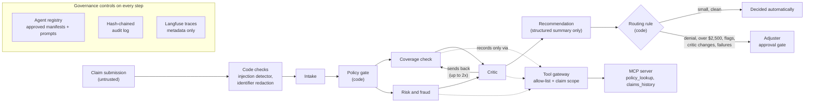

# hall-monitor

[](https://github.com/keeplearnin/hall-monitor/actions/workflows/ci.yml)
[](LICENSE)

Governance patterns for agentic AI in regulated financial services. Worked example: insurance claims triage.

Every agent needs a hall pass. hall-monitor checks it, watches where the agent goes, writes everything down, and calls a grown-up when it matters.

> **Status: early build, in public.** This repo is under active development (started November 2026). Each milestone ships with its eval numbers, including the bad ones. See [Roadmap](#roadmap) and [Results](#results).

## Why this exists

Most agent demos show what a model can do. Regulated firms need to know what an agent is allowed to do, who approved it, what it touched, and whether anyone can prove that six months later.

Those answers usually live in policy documents. hall-monitor puts them in code:

- **Every agent is registered** (its hall pass) before it can run, with an owner, a risk tier and an explicit tool allow-list.
- **Consequential decisions stop for a human**, and their decision is bound to the hash of the evidence pack they were shown.
- **Every triage and decision is logged** in an append-only, hash-chained audit trail that shows if anything was altered.
- **Every change is checked in CI**: tests, lint, the approvals check and the eval gate run on every PR, and a prompt or model change can't merge without a new approval. *The gate doesn't yet block regressions: the published results were scored on earlier agent versions, so it warns about stale results rather than failing until a fresh baseline is published.*
- **Every control maps to a framework** (NIST AI RMF and the FINOS AI Governance Framework), so risk, compliance and audit teams can evaluate it without reading the code. See [`docs/controls.md`](docs/controls.md).

The governance layer is the product. Claims triage is the proof that it works on a real-shaped regulated workflow.

## The worked example: insurance claims triage

When a customer files a claim, someone has to read it, check it against the policy, spot anything suspicious, and decide what happens next: pay it, ask for more information, investigate, or deny it. Claims are high-volume and time-sensitive, they carry personal and sometimes medical information, and a wrong denial harms a real customer. That makes triage a good test of whether governed agents can speed up the work without taking unacceptable risk.

The synthetic claims in this repo cover trip cancellation, lost or delayed baggage, and emergency medical expenses abroad.

The agents:

| Agent | What it does |
|---|---|
| **Intake** | Extract structured fields from the claim submission: claimant, policy number, incident date and type, amounts claimed, supporting documents. |
| **Coverage check** | Compare the claim with the policy wording and the policy record (fetched with `policy_lookup`) and work out what the policy pays, including exclusions, limits, deductibles and depreciation. |
| **Critic** | Check intake, coverage and risk against the claim documents and the policy, and send work back for correction (up to twice). |
| **Risk and fraud flags** | Flag inconsistencies, such as dates that don't line up, duplicate receipts, claims filed soon after a policy started, or earlier similar claims (fetched with `claims_history`), and assign a risk level. |
| **Recommendation** | Propose a next step with its reasons, from a structured summary only: no names, claim text or medical details. |

The agents never deny a claim or approve a large payout on their own. A routing rule written in code sends denials, payouts above $2,500, fraud flags, critic corrections, possible prompt injection and any failure (including any unexpected error) to a human adjuster, who decides at an approval gate. It also checks the claim against the policy record in code: a claimant who isn't the insured, an incident outside the coverage period, or a claim not in USD goes to a person, as does a claimed item or total that doesn't appear in the claim documents, or items that don't add up to the total. Tests bend each agent's answer in 22 ways a model could get it wrong, on every claim the answer key routes automatically, and check each one still reaches a person; the errors code can't see (a missed fraud signal, an overpayment within the amount claimed) are listed as known limits.

Agents get supporting records only through governed MCP tools (`policy_lookup`, `claims_history`). Every call goes through a gateway that checks the agent's allow-list and records the call. The policy wording is reference text and is still passed in directly.

All data in this repository is synthetic. No real customer, policy or claims data from any company is used.

## Architecture

How a claim moves through the system today (after milestone 9):



Every model call goes through one function that checks the agent's approved hall pass, calls the model the pass names, runs tool calls through the gateway and records what ran. Claims routed to a person wait at the approval gate (LangGraph, with state saved in SQLite) until an adjuster decides; every step is written to the audit log. More detail, and a plain-English version:

- [`docs/architecture.html`](docs/architecture.html), for engineering managers and architects
- [`docs/executive-brief.html`](docs/executive-brief.html), for business leaders
- [`docs/business-summary.md`](docs/business-summary.md), a one-page business summary in plain English
- [`docs/board-brief.md`](docs/board-brief.md), one page for a board or risk committee: the risks, the evidence, what isn't proven and the decisions a pilot would need
- [`docs/adr/`](docs/adr/README.md), 14 architecture decision records: why each design choice was made and what it costs
- [`docs/review/`](docs/review/README.md), the external review package and a log of every review so far and what it changed

GitHub shows HTML files as source, so download them and open them in a browser.

Tracing sends IDs, versions, hashes and token counts to Langfuse, never claim text or policy records: trace decorators don't capture function inputs or outputs, and the Anthropic SDK's spans stay metadata-only.

## Governance controls

Each control's NIST AI RMF and FINOS AIGF mapping is in the [controls register](docs/controls.md); the Register column gives its ID there.

| Control | What it does | Register | Status |
|---|---|---|---|
| Agent registry | Typed manifest per agent: ID, owner, risk tier, model, allowed tools, version. Unregistered, inactive or unapproved agents are refused at run time: the manifest digest and the system-prompt template hash must match `registry/approvals.yaml`, and the template hash is recorded on every call. The approvals file is a committed diff; who may approve it depends on repository settings (CODEOWNERS and branch protection). | HM-01, HM-02 | Built (milestones 1 and 3) |
| Tool allow-list | Agents can call only the MCP tools their manifest names; the gateway refuses anything else and records every call, allowed or refused | HM-03 | Built (milestone 4) |
| Adjuster approval gates | A LangGraph interrupt pauses every claim the routing rule sends to a person, with state saved in SQLite so it can wait across restarts. A decision counts only if it is signed with the adjuster's Ed25519 key, over the claim, every decision field and the evidence hash; code then checks their authority limit (for denials as well as payments), payout bounds on USD claims, that only a senior adjuster pays a claim with a fraud flag or above-low risk or one the AI never assessed, or decides a claim whose amount can't be compared with USD limits, and that overrides and denials carry a reason. The evidence pack is stored in the audit database under its hash, and the review step refuses a pack from the checkpoint that doesn't match it. The two fictional adjusters use public demo keys. | HM-04, HM-05 | Built (milestones 5 and 11) |
| Tamper-evident audit log | Append-only SQLite log; each entry's hash covers the previous one, triggers refuse edits and deletes, and `verify` reports any changed, missing or reordered entry. Events are written as they happen, so a run that dies part-way still leaves its trail. Entries hold IDs, hashes, decisions and costs, not the claim narrative or documents, and keep the adjuster's ID and a keyed hash (HMAC) of their written reason rather than the text; they do include policy numbers, decision fields and tool-call arguments. Someone with write access to the file could rewrite the whole chain consistently, so copy the chain head (`audit head`) somewhere else and verify against it. | HM-06 | Built (milestones 6 and 11) |
| PII and health-data redaction | Identifiers no agent needs (dates of birth, emails, phones, card numbers, passport and SSN numbers) are removed from the claim text, attachment file names and tool results before any model sees them; counts by type are recorded. Medical details stay, because coverage depends on them. Data classes are enforced at run time: each agent input and each tool declares the classes it carries (pii, health, financial), and anything beyond the agent's manifest is refused before the model or tool is called, so the recommender can't receive claim text, names or claims history (its structured input is still declared as health data, because a claim type or clause number can reveal a medical claim). No claim narrative in traces or the audit log. | HM-10, HM-11 | Built (milestones 8 and 11) |
| Model routing | A manifest may name a cheaper approved model and a claim-size limit; a code rule uses it for small claims, and critic-driven revisions always go back to the main model. Off by default until it is evaluated (`--model-routing`). | HM-16 | Built, off by default (milestone 7) |
| Cost and value telemetry | Cost per claim on every result and in the audit log, cache-aware, by agent and model; time to triage; human override rate; stopped-claim rate. The policy wording is prompt-cached. | HM-16 | Built (milestone 7) |
| Eval harness | Extraction accuracy, coverage-reasoning accuracy (with clause precision), hallucination rate, routing, cost and simulated override rate against ground truth; a seeded-error test of the critic; every run published with its findings | HM-12, HM-13 | Built (milestones 2-3, extended since) |
| Critic review | A second agent checks intake, coverage and risk against the documents and sends errors back; every revision is kept, and one that changes a decision field goes to a person | HM-07 | Built (milestone 3) |
| Prompt-injection defences | Claim text is fenced and escaped; a code detector sends claims with text aimed at the AI to a person; tool lookups are limited to the claim's own policy | HM-09 | Built (milestones 3, 4 and 8) |
| Fairness checks | Counterfactual runner: each claim re-run under names associated with six groups, swapped everywhere the name appears, counting outcome flips and per-group payment rates (`evals.fairness`). | HM-14 | Built; results need a live run (milestone 8) |
| Adversarial test suite | Ten attacks planted in real claims (instruction override, forged reviewer tags, claimed prior approval, data exfiltration, forged documents, PII) and scored on whether any worked (`evals.adversarial`). Defences: escaped claim text, a code detector that sends flagged claims to a person, and tool lookups limited to the claim's own policy. | HM-15 | Built; results need a live run (milestone 8) |
| CI eval gate | Every PR runs `evals.gate`: published results must meet the thresholds in `evals/gate.yaml` (accuracy, hallucination, unsafe routes, critic catch rate; attacks and fairness once run), and results scored on agent versions or prompts that are no longer approved, or that don't record them, are flagged. Live evals run on demand from a manual workflow. | HM-17 | Built (milestone 9); stale results warn until a fresh baseline |
| Framework mapping | 18 controls in `controls/controls.yaml`, each with its code, tests and evidence, mapped to NIST AI RMF 1.0 subcategories and FINOS AIGF v3 risks and mitigations, with what isn't covered and why. Tests fail if a reference goes stale or an ID isn't in the locally checked list (`controls/frameworks.yaml`). Readable version: [`docs/controls.md`](docs/controls.md). | All | Built (milestone 9) |

## Results

Numbers are published as each milestone lands, from runs anyone can reproduce with the commands in this repo.

| Milestone | Extraction accuracy | Coverage-reasoning accuracy | Hallucination rate | Cost per claim | Human override rate |
|---|---|---|---|---|---|
| Baseline (single pass, 6 claims x 3 trials) | 100.0% | 83.3% | 0.0% | $0.024 | n/a |
| Baseline (single pass, 26 claims x 3 trials) | 98.3% | 89.7% | 0.0% | $0.022 | n/a |
| Milestone 3 fixes, no critic (26 claims x 3 trials) | 98.6% | 100.0% | 0.0% | $0.022 | n/a |
| Milestone 3 with critic (26 claims x 3 trials) | 98.9% | 100.0% | 0.0% | $0.038 | n/a |
| Hardened, no critic (34 claims x 3 trials) | 98.5% | 98.0% | 0.0% | $0.024 | 3.3% (simulated) |
| Hardened, with critic (34 claims x 3 trials) | 98.7% | 98.0% | 0.0% | $0.039 | 1.7% (simulated) |

The two baseline rows use the same code; the second runs on a larger claim set. Milestone 3 computes the coverage label in code and stops when a policy can't be found, which took coverage reasoning to 100% without the critic. The critic's measured gain is on fraud flags: precision went from 92% to 100%, at about $0.016 more per claim. The amount slips it was built to catch didn't occur in either milestone 3 run, so that gain isn't measured yet. The hardened rows add 8 claims where a cap decides the amount, and fix the high-severity findings from two code reviews. No claim was routed automatically when it needed a person in any run. In the hardened run the critic raised no issues, so the gap between those two rows is run-to-run variation. A separate eval measures the critic directly by planting one error at a time in otherwise correct work. It caught all 84 planted errors, including all 16 amounts that ignored a cap, and raised 1 false alarm in 34 clean cases ([findings](evals/results/critic-seeded/findings.md)). Milestones 4-8 (governed data access, the approval gate, the audit log, caching and routing, and the privacy and injection defences) have passed their offline tests but are not yet in a scored live run. The pipeline numbers were scored at commit `d083a79` on intake-v2, coverage-check-v2, risk-fraud-v1, critic-v1 and recommendation-v2, and the critic eval at `ecd20c3` on critic-v1; every agent has been revised since (now intake-v3, coverage-check-v3, risk-fraud-v2, critic-v2 and recommendation-v3), so the numbers describe earlier versions until the next live run. Human override rate is simulated: an adjuster who always decides as the answer key does would have overridden the AI on 1 of 59 routed runs with the critic and 2 of 60 without, and no AI error went through automatically (`python -m hall_monitor.evals.override`). About 58% of runs go to a person, because the test claims are deliberately weighted towards edge cases. Details: findings for [6 claims](evals/results/baseline/findings.md), [26 claims](evals/results/baseline-26/findings.md), [milestone 3](evals/results/m3-critic/findings.md) and [the hardened pipeline](evals/results/hardened-critic/findings.md).

## Roadmap

1. ~~Repo, agent registry, synthetic claims and policies with ground truth, tracing~~ (done)
2. ~~Baseline eval run, results committed~~ (done)
3. ~~Critic agent and self-correction loop~~ (done)
4. ~~MCP servers: `policy_lookup`, `claims_history`~~ (done; eval results to follow)
5. ~~Adjuster approval gate with persistent checkpoints~~ (done)
6. ~~Hash-chained audit log~~ (done)
7. ~~Model routing and cost-per-claim telemetry~~ (done; routing to be evaluated)
8. ~~PII redaction, fairness checks and adversarial test suite~~ (done; attack and fairness results to follow)
9. ~~NIST AI RMF and FINOS AIGF mapping; CI eval gate~~ (done)
10. ~~Architecture decision records, one-page board brief, external review package~~ (done; reviews by people outside the project are invited)
11. ~~Hardening from the claims audit: audit events written as they happen, evidence stored by hash and checked before a decision, signed adjuster decisions, reasons hashed in the log, data classes enforced at run time, redaction of file names and tool results~~ (done)
12. Vendor test harness: adapters for guardrails, gateway policy and observability; routing and authority limits as policy code; OpenTelemetry export; automated anchoring; agent kill switch

Daily progress notes are in [`docs/devlog/`](docs/devlog/).

## Stack

Python 3.12 · LangGraph · Claude (Haiku and Sonnet) · MCP via fastmcp · Postgres + pgvector · Langfuse · DeepEval · FastAPI

In use today: Python 3.12, uv, Claude Haiku 5.5 and Sonnet 5.5 through the Anthropic SDK, Pydantic, fastmcp, LangGraph with a SQLite checkpointer (Postgres later), and Langfuse. The rest arrive with the milestones that need them.

## Quickstart

`run` triages a claim through all five agents, then decides it automatically or leaves it waiting for an adjuster. The eval commands call the Claude API and cost the amounts shown.

```bash
git clone https://github.com/keeplearnin/hall-monitor.git
cd hall-monitor
uv sync
cp .env.example .env   # add ANTHROPIC_API_KEY and Langfuse keys
uv run python -m hall_monitor.run --claim data/synthetic/claims/claim_001.json
uv run python -m hall_monitor.review list                  # claims waiting for an adjuster
uv run python -m hall_monitor.review show claim_004        # evidence pack and its hash
uv run python -m hall_monitor.audit verify                 # check the audit chain
uv run python -m hall_monitor.evals.baseline --trials 3     # 36 claims x 3, about $4
uv run python -m hall_monitor.evals.critic_seeded         # critic vs planted errors, about $2
uv run python -m hall_monitor.evals.adversarial            # attack suite, about $1
uv run python -m hall_monitor.evals.fairness               # name-swap fairness, about $10
uv run python -m hall_monitor.evals.override evals/results/hardened-critic  # no API calls
uv run pytest                                              # offline tests; no API calls
uv run python -m hall_monitor.evals.gate                   # check published results; no API calls
```

## Repository layout

```text
hall-monitor/
├── registry/                # Agent manifests, approvals.yaml, adjusters.yaml, manifest schema
├── hall_monitor/
│   ├── agents/              # Intake, coverage check, risk and fraud, critic, recommendation; base.py is the one call path
│   ├── tools/               # MCP server (policy_lookup, claims_history) and the tool gateway
│   ├── gateway/             # Cost, identifier redaction, injection detection
│   ├── governance/          # Routing rule, approval gate, audit log
│   ├── evals/               # Scoring, baseline, critic seeded test, override, adversarial, fairness
│   ├── pipeline.py          # Claim triage
│   ├── workflow.py          # LangGraph workflow with the approval gate
│   ├── run.py, review.py, audit.py  # CLIs: submit a claim, review as an adjuster, verify the log
│   └── registry.py, approvals.py, models.py, tracing.py
├── data/synthetic/
│   ├── policies/            # Policy wording and policy records
│   ├── claims/              # 36 claim submissions
│   ├── ground_truth/        # Expected extraction, coverage, risk, next step and route
│   ├── claims_history.json  # Earlier claims, served by claims_history
│   └── adversarial/         # Attack cases
├── controls/                # Controls register and the verified framework identifiers
├── evals/                   # gate.yaml thresholds; results/ holds published runs with findings
├── docs/                    # controls.md (generated), one-pagers, board brief, ADRs, review package, devlog
├── tests/                   # Offline tests; the Claude client is faked
├── var/                     # Runtime state: workflow checkpoints and audit log (git-ignored)
└── .github/workflows/       # CI on every PR; a manual live-eval workflow
```

## Design principles

- **Governance in code, not in documents.** If a control can't be tested, it doesn't count.
- **Humans make the consequential calls.** The agent prepares the evidence; an adjuster decides denials, large payouts and fraud.
- **Measure before you claim.** Every result in this README comes from a published run, with the agent versions it was scored on.
- **Model-agnostic by design.** Controls sit in the gateway and the graph, not inside one vendor's model.
- **Built for audit.** Any recommendation can be traced back to its inputs, model, prompt version, policy clauses and approver.

## Non-goals

- A production claims system. This is a reference implementation.
- A polished user interface. The evals, audit trail and control mapping are the point.
- Legal, compliance, underwriting or claims-handling advice.

## Contributing

Issues and pull requests are welcome, especially from people working on AI governance in insurance, banking and other regulated industries. If you've had to put an agent in front of an auditor or a regulator, I'd like to hear what they asked.

## Author

Built by Hari Perugu, engineering and AI platform leader in regulated financial services. LinkedIn

This is a personal project. It is not affiliated with, endorsed by, or built on the systems or data of any current or former employer.

## License

[Apache License 2.0](LICENSE)
